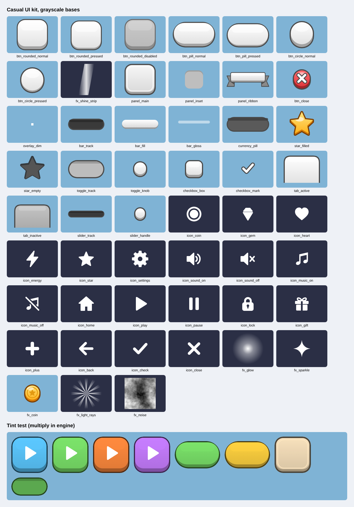

# Casual UI kit

Reusable UI asset kit for mobile casual games: buttons, panels, progress bars, controls, icons and FX textures.

**Live preview:** https://vrima1221.github.io/casual-ui-kit/



## How it works

- Most assets are grayscale bases with a dark outline. A multiply tint in the engine (for example `sprite.tint` in PixiJS) produces any color from one texture.
- Assets with a fixed color (close button, filled star, coin, disabled button, checkmark) are marked `"tintable": false`.
- Panels, buttons and bars are 9-slice. Borders are listed in `assets/manifest.json` and map directly to PixiJS `NineSliceSprite` (`leftWidth`, `topHeight`, `rightWidth`, `bottomHeight`).
- `fx_noise.png` is a tileable noise texture for dissolve and distortion shaders.

## Structure

```
assets/svg/        source vectors, grouped by category
assets/png/1x, 2x  rasterized exports, ready for atlas packing
assets/png_source/ raster-only textures (noise)
assets/manifest.json
index.html         tint preview page
```
